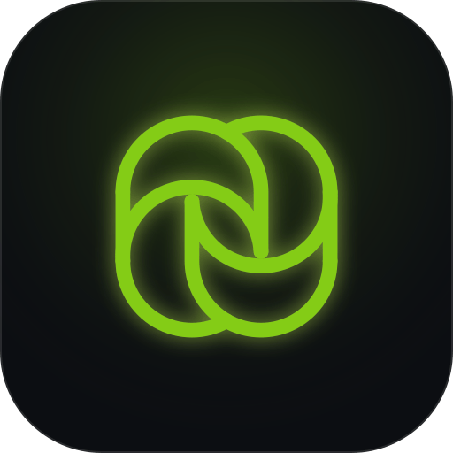

 
  <h1>Soma</h1>
  
Save over $1,000 a year on business cards and Try Soma.
 

Soma is the business card platform built for professionals looking to connect. Easy networking, easy ways to share your information with people you want.

The **Soma** is the [neuron's body where DNA is stored](https://blog.eyewire.org/somas-vs-synapses-special-brain-awareness-week-versus/#:~:text=A%20soma%20is%20a%20neuron%E2%80%99s%20cell%20body%2C%20home%20to%20the%20nucleus%20that%20contains%20DNA%20and%20many%20of%20the%20cell%E2%80%99s%20organelles.) - a representation of the connections that you can make on Soma. 

## Synapse by Soma
Synapses inside of a neuron is [the memories that you made along the day, which eventually gets passed into the hippocampus as it "parses" your memories from the day and remembers the most important events.](https://blog.eyewire.org/somas-vs-synapses-special-brain-awareness-week-versus/#:~:text=Your%20brain%20stores,a%20midday%20snack.) Synapse is an easy way to make connections, through multiple different methods:
- Connect at an event
  - Show on your Soma Profile that you are going to be visiting an event, and you will be able to connect with other people who are also at the event.
  - Live chat with other people currently at the event to meet up with them and talk, and easily exchange contact information.
  - Met someone but didn't get their Soma Card? Find them through Soma.
- Personal Feed
  - Let people follow you and get notifications when you are going to be speaking at an event or attending an event
*... and more coming soon*
